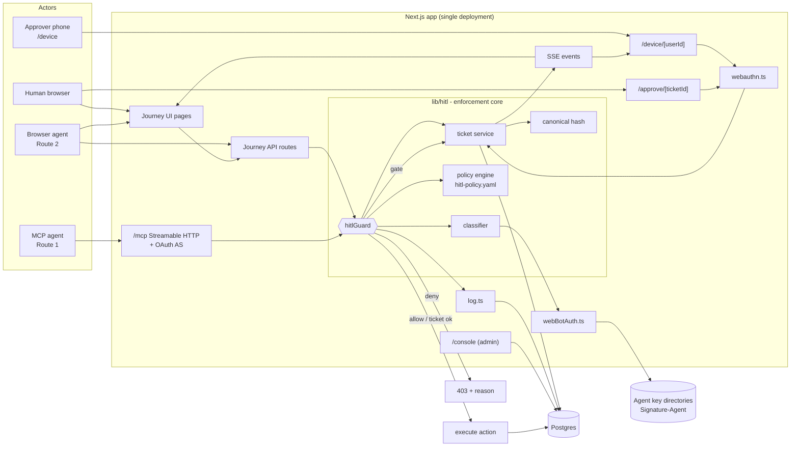
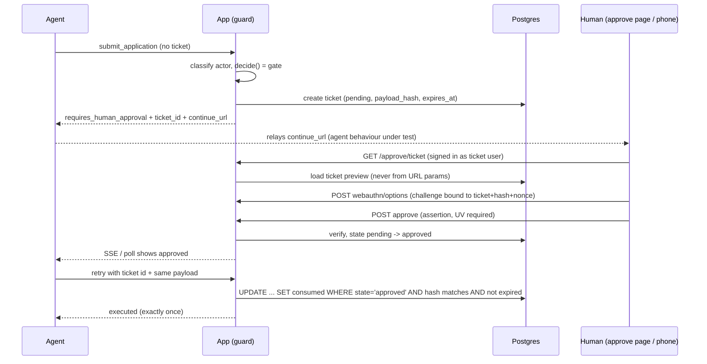

# Architecture: System-side HITL prototype ("DemoGov Permits")

Source: `ref/HITL-prototype-build-spec.md`. Status: **draft, awaiting owner sign-off**.

## 1. Shape

One Next.js (App Router, TypeScript) deployment. One Postgres database. Two entry routes (Web UI/API and MCP) converge on **one guard function**. That choke point is the whole point of the prototype, so everything else is arranged around keeping it single and bypass-proof.

## 2. System context and runtime flow

## 3. Gated-action sequence

## 4. Module boundaries

| Module | Responsibility | Depends on | Owns state |
|---|---|---|---|
| `lib/hitl/guard.ts` | The only decision+enforcement entry; returns ok / denied / gated / ticketInvalid | classifier, policy, tickets, hash, log | none |
| `lib/hitl/classifier.ts` | Per-request actor class + all signals | webBotAuth, session signals | none (reads `sessions`, signal rows) |
| `lib/hitl/policy.ts` | Load YAML at boot, `decide()` | yaml file | in-memory, read-only |
| `lib/hitl/tickets.ts` | Create, get, approve, reject, expire, atomic consume | db, hash | `hitl_tickets` |
| `lib/hitl/hash.ts` | Canonical JSON + SHA-256 | none | none |
| `lib/webauthn.ts` | Options/verify wrappers, UV check, challenge binding | simplewebauthn, db | `passkeys`, challenge nonce |
| `lib/webBotAuth.ts` | RFC 9421 verify, key-directory fetch + cache | network | key cache |
| `lib/sse.ts` | Ticket state fan-out | tickets | none |
| `lib/log.ts` | Writes `request_log` | db | `request_log` |
| `app/mcp` | Tool registry, step-scoped listing, gate-mode variants | guard, services | MCP sessions |
| `app/api/**`, UI | Thin adapters calling services via guard | guard | none |

Rule: journey services (create draft, submit, pay, etc.) are plain functions taking an authorised context. Routes and MCP tools are adapters that call `hitlGuard` first, then the service. A lint/unit check asserts that every mutating route and tool references the guard.

## 5. State ownership

- **Tickets:** Postgres only. State transitions happen in single conditional `UPDATE ... WHERE state=...` statements. This makes consume race-safe without locks.
- **Session and actor class:** class is recomputed per request, never cached on the session. The session stores raw signals only.
- **WebAuthn challenge:** server-side row or signed cookie holding `nonce` plus `ticket_id`. The expected challenge is recomputed as `H(ticketId || payload_hash || nonce)` at verify time.
- **Journey state for MCP:** derived from `applications.status`, so there is no separate state machine to drift.

## 6. Failure handling

- Guard fails closed. Any classifier or policy error becomes `gate` (or `deny` for critical actions), never `allow`.
- Web Bot Auth key fetch failure downgrades to "no signature signal". It never blocks and never upgrades trust.
- Ticket expiry is evaluated at read and consume time (`now() < expires_at`), and a sweeper only tidies state. Correctness does not depend on a cron.
- SSE drop: clients fall back to polling `GET /api/hitl/[id]`. Polling is the contract, SSE is a convenience.
- `HITL_MODE=observe`: guard computes and logs the decision, then returns ok. It must be impossible to enable in a production-flagged environment without an explicit env var.

## 7. Scalability

Test-scale only: tens of requests per minute, a few concurrent tickets. No caching layer, queue or worker is needed. The only concurrency requirement is the atomic consume.

## 8. Deployment options (recommendation first)

| Option | Pros | Cons |
|---|---|---|
| **A. Vercel + Supabase Postgres (recommended)** | Public HTTPS and stable domain immediately; the MCP tooling for both is already connected here | Serverless limits on long-lived SSE and on MCP server-initiated notifications (see risks) |
| B. Single VM / container + Postgres | Long-lived SSE and MCP sessions just work | More ops; TLS and domain setup |
| C. Local + `cloudflared` tunnel | Fastest for dev | Unstable URL means unstable RP ID; fine for Phases 0-2 only |

No cloud resources will be provisioned until the owner confirms (spec DECISION on domain and hosting).

## 9. Risks found in the spec

1. **Status code:** §9.1 pairs `403` with `WWW-Authenticate: ... insufficient_user_authentication`. RFC 9470 defines that error with `401`. Decide which; the test is whether agents react to the shape, so pick one and keep it fixed.
2. **SSE on serverless:** function timeouts cut streams. Use short-lived SSE with auto-reconnect and polling fallback, or choose option B.
3. **Step-scoped tools plus `list_changed`:** notifications need a long-lived server-to-client stream. Stateless serverless MCP can't push them. Compute `tools/list` from DB state per request (works everywhere) and treat push notification as best effort.
4. **OAuth authorization server inside the same app** (dynamic client registration, consent, `act` claim) is the largest single build item. Use the SDK's auth helpers rather than hand-rolling.
5. **URL elicitation (`-32042`)** depends on the SDK and client spec revision; build `tool_result` mode first, it's the universal fallback.
6. **`/device` is not truly out-of-band** if it uses the same platform authenticator on the same machine. Fine for protocol testing; note it in results when testers use one machine.
7. **Console admin auth** is unspecified. Assume a separate admin env-secret login.
8. **Payload hash scope:** define the volatile-field exclusion list per action up front. Otherwise a harmless field difference between ticket creation and retry causes false mismatches.
9. **Self-approval risk:** if an agent drives the human's already-signed-in browser, a platform authenticator still requires a user gesture and biometric. T4 verifies this; the virtual authenticator in CI is the exception and must never be enabled outside tests.
10. **"Muse"** remains unidentified (spec DECISION).
