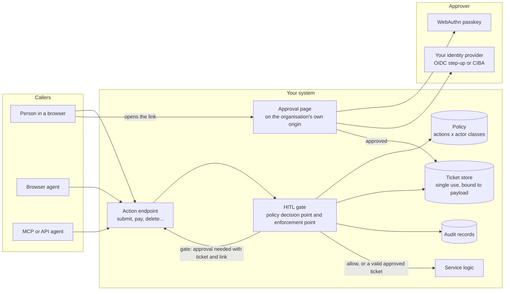

# HITL Gate Kit: design, build and implementation plan

**Where the work happens:** this note plans; it builds nothing. The kit itself (specification, conformance suite, SDK, guide) is built in its own repository, [WilsonWordsofWisdom/hitl-gate-kit](https://github.com/WilsonWordsofWisdom/hitl-gate-kit). 

**Inputs:**
- the prototype's code and controls ([docs/architecture.md](../architecture.md) section 7);
- the Phase 6 findings ([phase-6-red-team-findings.md](phase-6-red-team-findings.md));
- the standards research ([agent-standards.md](agent-standards.md), [trusted-agent-protocol.md](trusted-agent-protocol.md), [g6-g9-standards.md](g6-g9-standards.md));
- the passkey-step review and the H1 and H6 fixes ([decisions.md](../decisions.md), 2026-11-27);
- the owner's planning answers on 2026-11-27:
  - adopters' stacks are mixed or unknown;
  - v0.1 is the specification, tests and guide;
  - approvers are pluggable;
  - share privately first (superseded the same day: the owner decided the kit repository is developed in public).

## 1. Summary

- **Who it's for:** any organisation that runs an online service, whether enterprise, company, startup or public sector. It is generic and sector-neutral; the prototype's permit service is only the worked example.
- **What the kit is:** a way for any organisation to put a server-side human approval gate in front of irreversible actions in its own system, whatever its technology. A third-party AI agent can prepare an action, but **only the account holder's own strong approval can complete it**.
- **Shape, in four layers, each usable on its own:**
  1. a **specification** (HGK), independent of programming language;
  2. a black-box **conformance suite** an organisation runs against its own system;
  3. an **implementation guide**: how to choose actions, integrate, roll out and test with live agents;
  4. later, a **TypeScript reference SDK** taken out of the prototype.
- **v0.1** is layers 1-3; the SDK follows in v0.2.
- **Why specification first:** organisations run Java, .NET, Python and Node, so a TypeScript SDK alone would reach few of them. Black-box conformance tests let any implementation prove it holds.
- **What the evidence says:**
  - The prototype's gate held in live testing.
  - Behaviour detection scored 0 for a modern browser agent (Phase 6, F4).
  - So the kit makes the **gate and the approver** normative and keeps **agent detection advisory**. It never ships detection weights as if they were proven.
- **Effort:** v0.1 about **4-6 weeks** of one developer after foundations; v0.2 (SDK) another **3-4 weeks**.
- **The conformance suite must be proven to catch faults,** by running it against a deliberately broken example, not only against the prototype.
- **The kit is developed in public** (owner decision, 2026-11-27): the repository is public with an MIT licence. Everything pushed there is published at once, so it never receives secrets, live test data, results files or unreviewed research notes; releases are still a reviewed, human-gated step (K6).

## 2. Problem and audience

**The problem:** online services are now used by third-party AI agents, whether browser agents, MCP clients or personal agents. Agents can be manipulated, by prompt injection for example, can act beyond what the person intended, or can be covert. Detecting them is unreliable. What protects the person is making sure an irreversible step (submit, pay, delete, change recovery details) **cannot complete without the account holder's own approval of exactly that step**, enforced on the server.

**Who uses the kit:**

| Audience | Needs |
|---|---|
| System owner or product lead (enterprise, company, startup or public sector) | Decide which actions need approval; understand the risk reduced and the cost |
| Developer or integrator (any stack) | Exact behaviour to build, integration patterns, examples |
| Security assessor or auditor | Controls, threat model, conformance evidence, audit records |
| Tester | A way to prove the gate holds, including with live agents |

**Main journeys, which section 16 measures:**

| ID | Journey |
|---|---|
| KJ1 | Assess fit: read the overview and the threat model, choose the gated actions |
| KJ2 | Integrate in your own stack, following the specification and guide |
| KJ3 | Prove conformance: run the suite, get a report for the assessor |
| KJ4 | Roll out: observe, tune, then enforce, with time-boxed observe mode |
| KJ5 | Test with live agents, using the playbook and results template |
| KJ6 | Operate and audit: read the approval records, handle incidents |

## 3. What the prototype proved, and what it did not

| Proven (with evidence) | Not proven or still open |
|---|---|
| A server-side gate on submit and pay held against a live agent (Muse); the ticket was used exactly once; no self-approval (Phase 6, F1 and F2) | Only one agent and the web route were tested live. MCP, Poppy and other agents remain (Phase 6 next steps) |
| A ticket bound to the action, resource, payload and stored-state hash, single use, 10-minute lifetime (controls T1-T9), with 398 unit and 69 end-to-end tests | Behaviour detection did not detect Muse (F4); weights `draft-1` are untuned |
| A passkey bound to the ticket: challenge `H(ticket ‖ hash ‖ nonce)`, user verification (W1-W5) | **H2:** the person may not see what they approve when the agent controls the same browser. **H3:** same-browser approval is allowed even when an agent is suspected. **H4:** approval fatigue. **H5:** the user-verified flag is the authenticator's own claim |
| Enrolment protected by a one-time code or a passkey sign-in (W12, H1 fixed); observe mode time-boxed (C6, H6 fixed) | No attestation policy, no notice of new passkeys, no cooling-off period (decision 2026-11-27) |
| Declared agents recognised (Web Bot Auth, MCP token, Poppy, self-declaration) | Covert agents can't be identified by any standard (G9) |

**How the kit uses this:**
- The proven parts become **normative** requirements.
- The open gaps become **requirements for the approver** (section 6.2) or **known limitations** in the guide.

## 4. Scope

**In scope (v0.1-v0.3):**
- the gate and tickets;
- approver requirements and profiles;
- the policy format;
- agent-facing responses (web, API, MCP; optionally Poppy);
- audit records;
- observe mode;
- the conformance suite;
- the guide and live-agent test playbook;
- the reference SDK.

**Non-goals:**
- **An identity provider or account system.** The kit uses the organisation's own.
- **A bot-detection product.** Detection is advisory input, never the control that holds.
- **A web application firewall or edge product.** The gate sits at the action boundary inside the system.
- **Classifier weights presented as proven.** Each organisation tunes its own, or uses none.
- **Payments-specific standards** (Secure Payment Confirmation, AP2, Visa TAP). These stay optional notes.
- **Hosting a service for adopters.**

## 5. Kit architecture

### 5.1 The four layers

| Layer | What it is | Who uses it | Release |
|---|---|---|---|
| Specification (HGK) | Requirements written with RFC 2119 keywords, plus JSON Schemas and an OpenAPI description of the endpoints that agents and approvers call | Developers, assessors | v0.1 |
| Conformance suite | Black-box HTTP tests run as a Docker image against the organisation's system, with a JSON and HTML report | Testers, assessors | v0.1 |
| Implementation guide | Threat model, choosing actions, integration patterns per stack, rollout, live-agent test playbook, limitations | Everyone | v0.1 |
| Reference SDK (TypeScript) | Packages for the core, approvers, storage and framework adapters, extracted from the prototype | Node developers; a model for ports | v0.2 |

### 5.2 How the gate fits into an organisation's system



**How a gated action flows:**
1. The gate decides `allow`, `gate` or `deny` from the policy and the actor class.
2. On `gate`, it creates a ticket bound to the exact request and stored state, and answers with a link to the approval page.
3. The person approves on the organisation's origin with an approver that meets section 6.2.
4. The original requester resends the request with the ticket.
5. The gate uses the ticket up, once, and the action runs.
6. Every step is recorded.

**Alignment with OpenID AuthZEN:**
- An organisation that already runs a policy decision point (Open Policy Agent, Cedar, or an AuthZEN service) can make the allow, gate or deny decision there.
- The kit defines how that decision maps to AuthZEN's subject, action, resource and context (section 6.3).
- Tickets and approval always stay in the gate. The policy engine never approves.

## 6. Specification design (HGK v0.1)

One document per part, versioned together (semantic versioning). The requirement IDs below are proposals; each traces back to a prototype control.

### 6.1 HGK-Core: gate, tickets and responses (normative)

| ID | Requirement (summary) | From |
|---|---|---|
| CORE-1 | Every state-changing action passes one enforcement point before it runs; no route or tool bypasses it | C1, T11 |
| CORE-2 | The decision (`allow`, `gate`, `deny`) is made on the server from a declared policy; an action not listed and not marked read-only is denied | C2, C4 |
| CORE-3 | Fail closed: an error in classification or policy gives `gate` (or `deny` for critical actions), never `allow` | C3 |
| CORE-4 | Resource ownership is checked on every access | C5 |
| CORE-5 | A ticket is bound to the user, action, resource and a hash of the request (excluding named volatile fields) plus the stored state. A **deterministic canonical form** is required; RFC 8785 (JCS) is recommended, and required wherever two systems must produce the same hash (for example a gateway and a back end in different languages, or an auditor recomputing hashes). Input that can't be canonicalised is refused, never hashed: `NaN`, `Infinity`, strings with broken Unicode (lone surrogates), and values that aren't plain JSON (for example dates). The prototype's form is checked against the RFC 8785 test vectors in K2 | T1 |
| CORE-6 | Ticket IDs carry at least 128 bits from a cryptographically secure random generator | T4 |
| CORE-7 | Lifetime at most 10 minutes, checked when the ticket is read and when it is used | T3 |
| CORE-8 | States: `pending → approved → consumed`; `pending → rejected / expired`. No other transitions | T5 |
| CORE-9 | A ticket is used exactly once, atomically; concurrent attempts produce one winner | T2 |
| CORE-10 | Only the requester can redeem: the same session (web) or the same OAuth client plus user (API, MCP); anyone else gets `wrong_session` | T6 |
| CORE-11 | A changed payload or stored state after approval is refused (`payload_mismatch`) and needs a new approval | T1, test T5 |
| CORE-12 | The gated response, defined in section 6.1.1 | FR21, FR24 |
| CORE-13 | Approval links and redirects are built from configured origins only, never from request data | T7, S7 |
| CORE-14 | Messages to agents are declarative and addressed to the person; no instructions aimed at models, no secrets | P1-P3 |
| CORE-15 | Ticket creation and approval attempts are rate limited per user and per network address | T9 |
| CORE-16 | Observe mode (log decisions without enforcing) needs an explicit second switch and an end time at most 24 hours ahead. It is announced to everyone while on, and enforcement resumes by itself | C6, H6 |

#### 6.1.1 The gated response (CORE-12)

- **HTTP status:** `403` by default; `401` or `202` are allowed as a deployment choice (the prototype's `HITL_GATE_STATUS`).
- **Step-up header:** `WWW-Authenticate: Bearer error="insufficient_user_authentication", acr_values="<deployment URN>"`, from **RFC 9470** (OAuth 2.0 Step-Up Authentication Challenge).
- **JSON body,** with a JSON Schema in the specification:
  - `status: "requires_human_approval"`;
  - `action`;
  - `ticket_id`;
  - `continue_url`;
  - `message_for_user`;
  - `resume` (`poll`, `retry_with_header`, `expires_at`).
- **Other outcomes** have their own schemas: `denied`, `rate_limited`, and `ticket_invalid` with reasons `not_found | wrong_session | not_approved | rejected | expired | consumed | payload_mismatch`.
- **Ticket on retry:** `HITL-Ticket: <id>`.
  - `X-HITL-Ticket` is accepted for compatibility; RFC 6648 discourages `X-` prefixes for new headers (header name confirmed in K2).
  - Forms may send `hitl_ticket` instead.
- **Status endpoint:** `GET <poll>` returns the ticket state to its requester only.
- **MCP profile:** gated tool calls return the same body as a tool result, or ask for a URL with MCP URL elicitation. Tools for gated actions declare it in their descriptions (prototype controls M1-M7).
- **Poppy profile (optional):** for agents that declare Poppy Operations, map the ticket to an `operation` with a revision that records whether passkey approval was given; the agent's own approval never completes a gated step (PP3, PP4).

### 6.2 HGK-Approver: what any approver must prove (normative), and profiles

**Required properties for every approver:**

| ID | Requirement | Gap addressed |
|---|---|---|
| APR-1 | Approval is cryptographically bound to **this ticket and this payload hash**: an approval for one can't approve another | W2 |
| APR-2 | The approver is the **ticket's account holder**, verified with user verification (biometric or PIN), not only possession | W1, W3 |
| APR-3 | An approval assertion can be used once | W2 |
| APR-4 | The approval page shows a summary from the **ticket record** (never from URL parameters) on the organisation's own origin, displayed prominently | T8, W4 |
| APR-5 | **Enrolment protection:** a password alone can't register an approver credential. A first credential needs an out-of-band proof (for example an admin-issued one-time code or identity proofing); another needs an existing credential | W12, H1 |
| APR-6 (should) | When the requesting session shows agent evidence or suspected handover, approval should happen on **a different device or session** from the requester's | H2, H3 |
| APR-7 (should) | Show a short confirmation code on both the requesting screen and the approval screen; limit pending approvals per user; cool down after a decline | H4 |
| APR-8 (may) | An attestation policy for approver credentials where the population allows it; note that synced passkeys send none | H5 |

**Profiles:**

| Profile | How it meets the required properties | Status |
|---|---|---|
| **WebAuthn** | Challenge `SHA-256(ticket_id ‖ payload_hash ‖ nonce)`, nonce stored once on the server; `userVerification: required`; origin and RP ID checked; credential belongs to the ticket's user; enrolment as in APR-5 | Proven in the prototype |
| **OIDC step-up** (the organisation's identity provider) | Authentication request with `acr_values` and `max_age=0` and `nonce = base64url(SHA-256(ticket_id ‖ payload_hash ‖ server nonce))`. Verify the ID token's signature, `iss`, `aud`, `nonce`, `acr` and `auth_time`, then approve the ticket | **To validate** with two real identity providers (the binding through `nonce` is an assumption) |
| **CIBA, with RAR** | A back-channel request with a `binding_message` showing the confirmation code, and `authorization_details` naming the action and resource; the approval comes back on the person's own device | **To validate**: needs an identity provider with CIBA. This also closes G3 (a real phone channel) |

### 6.3 HGK-Policy: the policy format (normative)

- **The file:** a YAML or JSON document with a JSON Schema in the specification. It contains:
  - `read_only` actions;
  - per-action decisions for each actor class (`human`, `declared_agent`, `suspected_agent`, `unknown`);
  - `critical` actions, where a failure means deny;
  - gate settings (lifetime, approver profiles allowed).
- **Rules:** loaded at start-up, read-only; invalid policy stops start-up.
- **The prototype's file** [policy/hitl-policy.yaml](../../policy/hitl-policy.yaml) is the example.
- **AuthZEN mapping:** subject = user plus actor class; action = action name; resource = type plus ID; context = route and evidence. The decision maps to allow, gate or deny through a documented context field. This lets an organisation's existing decision point decide while the gate enforces.

### 6.4 HGK-Actor: actor classes and evidence (mostly informative)

**Normative:**
- the classes;
- the precedence of evidence (protocol identity, then self-declaration, then behaviour score, then default);
- **escalate-only:** agent evidence is never lowered in a session;
- detection **never loosens** a decision: a verified agent gets no extra privileges.

**Informative:**
- the behaviour signals;
- protocol identity sources: Web Bot Auth with replay protection and path binding (optional Phase 8), MCP tokens, Poppy sessions and browser joins;
- **an explicit warning,** with the Phase 6 evidence, that behaviour signals may score 0 for modern agents. The policy must be safe if every agent is `unknown`.

### 6.5 HGK-Audit: audit records (normative minimum)

- **What gets a record:** every gate decision, ticket change, approval, decline, redemption, denial and observe-mode decision.
- **Fields,** from the prototype's `request_log`:
  - time;
  - route;
  - action;
  - user;
  - session or client;
  - actor class and evidence;
  - decision;
  - ticket;
  - outcome;
  - reason;
  - hashed network address.
- **Never recorded:** secrets, tokens, enrolment codes or approval assertions.
- **Retention:** set by the organisation. The guide gives defaults and data-protection notes.

### 6.6 HGK-Rollout: observe, tune, freeze, enforce (informative)

- **Order:** observe mode (time-boxed, CORE-16), then tuning, then freezing the weights, then enforcement.
- **The live-agent test matrix:** T1-T15 and T10a-d with standard prompts, taken from [tests/results/README.md](../../tests/results/README.md).
- **Reporting rules:** detection rates only after the freeze, labelled "tuned on the same agents".

### 6.7 Conformance levels

| Level | Requires | Typical use |
|---|---|---|
| **HGK Level 1** | All of HGK-Core, plus one approver profile meeting APR-1 to APR-5 | Minimum for production |
| **HGK Level 2** | Level 1, plus HGK-Audit, CORE-15 (rate limits), CORE-16 (observe controls) and APR-6 | Recommended |
| **HGK Level 3** | Level 2, plus the MCP profile and, where relevant, protocol identity checks (Web Bot Auth strict, Poppy) | Systems open to agent protocols |

## 7. Conformance suite design

**How it runs:**
- **Packaging:** a Docker image (`ghcr.io/<owner>/hgk-conformance`), so organisations need no Node toolchain. The runner itself is TypeScript with Playwright.
- **Configuration:** `hgk.config.yaml`, which sets:
  - the base URL;
  - two test accounts, the second for cross-user tests;
  - for each gated action, the method, path, body, how to make the action ready, and how to change its payload;
  - how to sign in;
  - the approver driver.
- **Approver drivers:**
  - `webauthn-virtual`: a virtual authenticator in the browser. The target must have a test mode that accepts a test passkey enrolled with a code (APR-5);
  - `oidc-mock`: the suite ships a mock identity provider that the target trusts in its test environment;
  - `manual`: the suite pauses and the tester approves by hand.
- **Outputs:** JUnit XML for CI, a JSON result file, and an HTML report listing each requirement ID with pass, fail or skip, and the evidence.
- **Safety:** run only against test environments. The suite creates and approves test tickets and refuses a base URL marked as production unless explicitly overridden.

**Test catalogue (v0.1, about 30 tests):**

| Group | Tests (requirement IDs) | From |
|---|---|---|
| Gate coverage | Unlisted mutating action denied (CORE-2); each gated action without a ticket returns the gated response (CORE-1, CORE-12); schema and header check (CORE-12) | C1, C4, T11 |
| Tickets | Pending ticket can't be used (not_approved); approved ticket works once (CORE-9); a second use is `consumed`; parallel use gives one winner (CORE-9); expiry (CORE-7, with a short lifetime in test mode); changed payload gives `payload_mismatch` (CORE-11); changed stored state gives `payload_mismatch`; another session or user gives `wrong_session` (CORE-10); ID entropy and format (CORE-6) | T1-T6, tests T5-T7 |
| Responses | No client URL reflected in `continue_url` (CORE-13); messages contain no model-directed instructions (CORE-14, with the prototype's text lint) | T7, P1-P3 |
| Approver | Approval for ticket A can't approve B (APR-1); approval without user verification is refused (APR-2); another account can't approve (APR-2); summary comes from the ticket record, not the URL (APR-4); enrolment with a password alone is refused (APR-5) | W1-W4, W12 |
| Limits and modes | Ticket-creation rate limit (CORE-15); observe mode without an end time refused (CORE-16, configuration test where possible); observe notice present (CORE-16) | T9, C6 |
| Audit (Level 2) | Records exist for gated, approved, consumed and refused events, with the required fields and no secrets (HGK-Audit), through an export endpoint the target exposes in test mode | L1, L4 |
| MCP (Level 3) | Gated tool returns the gated result or URL elicitation; the ticket redeems once for the same client (MCP profile) | M1-M7 |

**Proving the suite catches faults:**
- **Against the prototype:** `systemsideHITL` must pass Level 2, and it is the suite's first CI target.
- **Against a deliberately broken example:** a small demo service in the kit repository with switches that each break one requirement (allow reuse, skip the payload check, accept any account's approval, build URLs from the request). The suite must fail the matching test for every switch. This mutation-style check is what makes a "pass" credible to an assessor.

## 8. Reference SDK design (v0.2)

**Packages:**

| Package | Responsibility | From the prototype |
|---|---|---|
| `@hgk/core` | Policy loading and decision, actor classification framework, payload hashing, ticket state machine, the guard, response builders. No framework or database code | `lib/hitl/policy.ts`, `classifier.ts`, `hash.ts`, `tickets.ts` (logic), `guard.ts`, `response.ts` |
| `@hgk/webauthn` | WebAuthn approver profile: challenge binding, verification, enrolment rule and codes | `lib/hitl/approval.ts`, `app/api/hitl/[ticketId]/approve`, `lib/auth/webauthn.ts`, `lib/auth/enrolment-codes.ts` |
| `@hgk/oidc` | OIDC step-up approver profile (and CIBA later) | New |
| `@hgk/postgres` | Storage adapter: tickets, challenges, rate limits, audit records, with migrations | `lib/db/schema.ts` (HITL tables), `lib/ratelimit.ts` |
| `@hgk/express`, `@hgk/next` | Framework adapters: middleware and route helpers, the approval page handler | `lib/journey/handler.ts`, `lib/hitl/approve-request.ts` |
| `@hgk/signals` | Browser behaviour signals, optional and advisory | `public/signals.js`, `lib/hitl/inputs.ts` |
| `@hgk/mcp` | MCP tool wrapper and gate modes | `lib/mcp/tools.ts` |
| Later: `@hgk/web-bot-auth`, `@hgk/poppy`, `@hgk/console` | Optional identity profiles and an admin console | `lib/webBotAuth.ts`, `lib/poppy/*`, `app/console` |

**Interfaces an organisation implements (ports):**

| Interface | What it supplies |
|---|---|
| `ActionRegistry` | Per gated action: name, resource ID, a function that checks preconditions and returns the stored-state snapshot and a preview, and the volatile fields. In the prototype this is [lib/hitl/snapshot.ts](../../lib/hitl/snapshot.ts) |
| `SessionAdapter` | Who the user is, the session or client ID, sign-in method, and an approval-only session for the approval page |
| `Storage` | Atomic conditional updates for tickets and challenges, rate-limit counters and audit records (Postgres adapter provided) |
| `Approver` | One of the profiles in section 6.2 |
| `AuditSink` | Where records go: database, log pipeline or security event system |
| `Clock` | Testable time |

**Changes from the prototype during extraction:**
- the policy and classifier configuration become injected objects, not files read at boot;
- the `HITL-Ticket` header, with `X-HITL-Ticket` still accepted;
- JCS canonicalisation tested against RFC 8785 test vectors;
- no Next.js or Drizzle in `@hgk/core`;
- **dogfooding:** the prototype is moved onto the SDK and must still pass all its own tests and the suite.

**Dependency policy:**
- `@hgk/core` depends only on the platform's crypto and a schema validator.
- Every dependency is checked on the registry before it is added (control B1).

## 9. Implementation guide (v0.1 outline)

1. **Overview:** what the gate does and doesn't do; the 2-minute version for decision-makers.
2. **Threat model:**
   - manipulated agents (prompt injection);
   - over-reaching agents;
   - covert agents;
   - stolen sessions and tokens;
   - same-browser approval (H2, H3);
   - approval fatigue (H4);
   - enrolment takeover (H1);
   - misconfiguration (H6).

   Each is mapped to HGK requirements and residual risk.
3. **Choosing what to gate:** irreversible, financial, identity and recovery changes, data export. A decision worksheet. Why detection must not be the gate.
4. **Integration patterns:**
   - Java/Spring, .NET, Python/Django and Node/Express, written as pseudocode plus each framework's own interception points;
   - the action registry;
   - storage needs: atomic conditional updates;
   - the approval page;
   - agent-facing responses.
5. **Approvers:** WebAuthn with enrolment codes; step-up through the organisation's identity provider; CIBA. Choosing between them; accessibility and recovery.
6. **Rollout:** observe with an end time, tune, freeze, enforce; communication to users.
7. **Testing:** running the conformance suite; the live-agent playbook (prompts, run IDs, ground truth, results template); interpreting results honestly (Phase 6 lessons).
8. **Operations:** audit records, alerts, incident handling (approval storms, suspected handover), data protection.
9. **Known limitations and roadmap:** H2-H5 residuals, G6-G9 standards options, payments.
10. **Appendices:** requirement checklist, glossary, the prototype's evidence summary.

## 10. Kit repository structure (proposal)

```
hitl-gate-kit/
  spec/                 HGK-Core, -Approver, -Policy, -Actor, -Audit, -Rollout (Markdown, RFC 2119)
  schemas/              JSON Schemas (gated response, outcomes, policy, audit record) + OpenAPI
  conformance/          suite source, Dockerfile, mock IdP, sample hgk.config.yaml
  examples/
    broken-service/     deliberately faulty target with fault switches (suite self-test)
    express-minimal/    smallest correct integration (v0.2, on the SDK)
  packages/             @hgk/* (v0.2)
  guide/                implementation guide
  docs/                 PRD.md, decisions.md, architecture.md, design.md, tests/ (living docs per SOP)
  .github/              CI workflows (actions pinned to commit SHA), CODEOWNERS, templates
  SECURITY.md  CONTRIBUTING.md  CHANGELOG.md  LICENSE (code)  LICENSE-spec (specification and guide text; chosen in K0)
```

## 11. Engineering, security and supply chain (kit repository)

- **CI on every pull request:**
  - format, lint and typecheck;
  - unit tests;
  - schema validation of examples;
  - the conformance self-test (prototype passes, every broken-service fault is caught);
  - secret scan (for example gitleaks);
  - dependency review and audit;
  - static analysis (CodeQL or Semgrep).
- **Every change to CI or build files needs explicit owner review** (B3).
- **Third-party GitHub Actions are pinned to commit SHAs** (B2).
- **Releases:**
  - signed tags;
  - npm packages published with provenance (Sigstore), from CI only;
  - an SBOM (CycloneDX) attached;
  - a signed container image for the suite;
  - aim for SLSA build level 2 at first.

  Release is a human-gated step, never automatic on merge.
- **Repository protection:**
  - branch protection on `main`;
  - required reviews;
  - OpenSSF Scorecard;
  - `SECURITY.md` with a private reporting route (GitHub private vulnerability reporting).
- **Tests are never deleted or weakened** to pass CI (B5); security tests need human review.
- **No secrets in the repository.** Examples use placeholders; the mock identity provider generates throwaway keys at start-up.

## 12. Build plan

Effort is for one developer, as an estimate. **"Kit"** means work in the `hitl-gate-kit` repository; **"Prototype"** means work in `systemsideHITL`. Each step has a check that proves it is done.

| Phase | Steps | Repo | Verify | Effort |
|---|---|---|---|---|
| **K0. Prerequisites** | 1. Owner chooses the licence for the specification and guide text (MIT like the code, or CC BY 4.0) and confirms the right to publish this work, **before the first content is pushed to the public kit repository**. 2. More Phase 6 runs: Muse in enforce through to payment, P2 and P3, the covert variant (`SELF_DECLARE_UI=off`), and at least two more agents, as evidence for the guide | Owner, Prototype | Decisions logged; results files merged | Owner time |
| **K1. Foundations** | PRD (the journeys in section 2, metrics in section 16), decisions log, architecture with a Mermaid diagram, design notes; CI skeleton with pinned actions, `SECURITY.md`, `CODEOWNERS`, branch protection | Kit | Owner sign-off on the PRD and architecture; CI green on an empty pull request | 2-3 days |
| **K2. Specification v0.1** | HGK-Core, -Approver (with WebAuthn complete; OIDC and CIBA marked draft), -Policy (with AuthZEN mapping), -Actor, -Audit, -Rollout; JSON Schemas and OpenAPI; a requirement ID index tracing each requirement to a prototype control; **run the prototype's `canonicalJson` against the RFC 8785 test vectors** and record any differences as decisions (a fix in the prototype gets its own pull request and test) | Kit + Prototype | Schemas validate the prototype's real responses; each requirement has a source and a planned test; the canonicalisation check passes or each difference is decided | about 1 week |
| **K3. Conformance suite v0.1** | Runner, config format, approver drivers (webauthn-virtual, manual; oidc-mock as a stretch), the test catalogue in section 7, HTML and JSON report, Docker image; the `broken-service` example | Kit | Every broken-service fault switch makes the matching test fail; the suite runs from the image with only a config file | 1½-2 weeks |
| **K4. Validate against the prototype** | Add `hgk.config.yaml` and the test-mode hooks the suite needs (a code for a test passkey, a short ticket lifetime, an audit export) to the prototype; fix any differences on either side | Prototype + Kit | The prototype passes Level 2; differences recorded as decisions | 2-3 days |
| **K5. Implementation guide v0.1** | Chapters in section 9, with the prototype as the worked example and Phase 6 evidence | Kit | Read-through by the owner and one developer from outside the project; checklist complete | 1-2 weeks |
| **K6. Release v0.1** | Changelog, signed tag, signed suite image, release notes with limitations; published in the public repository | Kit | Release artefacts verify (signature, SBOM); owner approves the release | 1-2 days |
| **v0.2. Reference SDK** | Extract `@hgk/core`, `@hgk/webauthn`, `@hgk/postgres`, `@hgk/express`, `@hgk/next`; OIDC step-up profile validated with two identity providers; `examples/express-minimal`; move the prototype onto the SDK | Kit + Prototype | The SDK example and the prototype both pass Level 2; all 398 unit and 69 end-to-end tests in the prototype still pass | 3-4 weeks |
| **v0.3. Profiles** | CIBA with RAR (closes G3); MCP profile tests (Level 3); Web Bot Auth strict (Phase 8) and Content-Digest (G7); explore the gateway pattern for older systems | Kit + Prototype | Level 3 passes for the prototype | 3-4 weeks |

**Total:** v0.1 about 4-6 weeks after K0; v0.2 3-4 weeks; v0.3 3-4 weeks.

## 13. Relationship with the prototype

- **What the prototype becomes:** it stays the **research testbed**, the **first conformance target** and, from v0.2, the **first SDK user**.
- **How changes flow:**
  - A control first proven in the prototype goes into the specification with its evidence.
  - A specification change that affects the prototype gets a prototype pull request and a test.
- **Versions:** each kit release notes the prototype version it was validated against.
- **What stays here, never copied to the kit:** research notes, live test data and results files. They hold run IDs and observations; the guide uses summaries only.

## 14. Risks and mitigations

| Risk | Mitigation |
|---|---|
| Developing in public: drafts and mistakes are visible at once | Push only reviewed content; never secrets, live test data or results files; mark drafts as such; releases (K6) are reviewed and signed |
| The suite passes faulty implementations | The broken-service fault switches must all be caught (section 7) |
| OIDC or CIBA binding assumptions fail with real identity providers | Profiles marked draft until validated with two providers; WebAuthn is the complete profile for v0.1 |
| Adopters treat detection as the control | HGK-Actor is informative; the guide's threat model and the Phase 6 evidence say so plainly; Level 1 must be safe with every agent `unknown` |
| Approver gaps H2-H4 remain | APR-6 and APR-7 as "should" in Level 2; the guide gives the options (separate device, codes, CIBA) |
| Scope creep: SDK, console and profiles all at once | Specification-first v0.1; the SDK in v0.2; profiles in v0.3 |
| Supply-chain risk in a security kit | Section 11: pinned actions, provenance, SBOM, scans, human-gated releases |
| Maintenance burden on one person | Small v0.1; a clear support statement in the README ("best effort, no service level" for v0.1); conformance tests make outside contributions safer |
| Live-agent evidence is thin (one agent) | K0 step 2 before K5; the guide reports limits honestly |

## 15. Success measures

- **North star:** the number of systems that pass **HGK Level 1** conformance in their test environment.
- **Supporting measures:**
  - time from first read to a passing Level 1 run (KJ2, KJ3);
  - the share of broken-service faults the suite catches (target 100%);
  - in live-agent tests on conforming systems, the share of gated actions that ran without the account holder's approval (target 0);
  - defects found in real systems by the suite;
  - outside reviewers' rating of the guide.
- **Tracking:** the kit PRD tracks these, following the analytics approach used for the prototype.

## Sources

- **Prototype:**
  - controls, [docs/architecture.md](../architecture.md) section 7;
  - [docs/decisions.md](../decisions.md);
  - [phase-6-red-team-findings.md](phase-6-red-team-findings.md);
  - [g6-g9-standards.md](g6-g9-standards.md);
  - [agent-standards.md](agent-standards.md);
  - [trusted-agent-protocol.md](trusted-agent-protocol.md).
- **Standards referred to:**
  - [RFC 9470: OAuth 2.0 Step-Up Authentication Challenge](https://www.rfc-editor.org/rfc/rfc9470);
  - [RFC 8785: JSON Canonicalization Scheme](https://www.rfc-editor.org/rfc/rfc8785);
  - [RFC 6648: deprecating the "X-" prefix](https://www.rfc-editor.org/rfc/rfc6648);
  - [RFC 2119: requirement keywords](https://www.rfc-editor.org/rfc/rfc2119);
  - [W3C WebAuthn Level 3](https://www.w3.org/TR/webauthn-3/);
  - [OpenID Connect Core 1.0](https://openid.net/specs/openid-connect-core-1_0.html) (`nonce`, `acr`, `max_age`);
  - [OpenID CIBA Core 1.0](https://openid.net/specs/openid-client-initiated-backchannel-authentication-core-1_0.html);
  - [RFC 9396: Rich Authorization Requests](https://rfc-editor.org/rfc/rfc9396);
  - [OpenID AuthZEN Authorization API 1.0](https://openid.net/specs/authorization-api-1_0.html);
  - [MCP specification](https://modelcontextprotocol.io/specification).
- **Supply chain:**
  - [npm provenance](https://docs.npmjs.com/generating-provenance-statements);
  - [SLSA](https://slsa.dev/);
  - [OpenSSF Scorecard](https://github.com/ossf/scorecard);
  - [CycloneDX](https://cyclonedx.org/).
